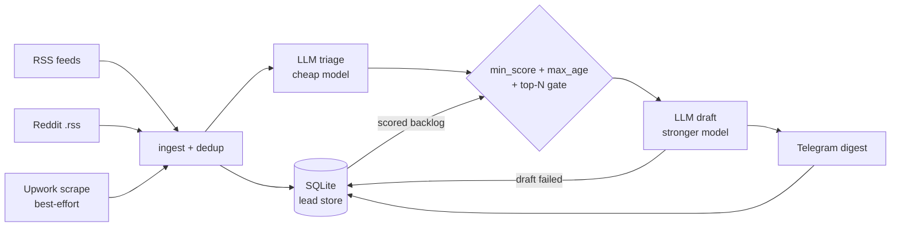

# gig-radar

[](https://github.com/ssh071102-code/gig-radar/actions/workflows/ci.yml)


gig-radar is an LLM scoring pipeline: it collects postings from several sources, scores each
one against a profile you write using a cheap model, drafts replies for the few best matches
with a stronger model under a per-run cap, and sends them to Telegram for review.

The bundled config and demo use job and project postings (remote job boards, Reddit hiring
threads) as example data. Sources, scoring criteria and the profile all live in config files.

## Demo output

Output of `gig-radar demo`, which runs the real pipeline on bundled fixture postings with no
API keys and no network:

```text
gig-radar demo -- bundled fixture data, no network, no API keys

Scored postings (demo fixtures):
   92  ai-integration  [Hiring] Build a support chatbot grounded in our product docs (RAG)
   84  automation      [Hiring] Automate weekly ops reporting from Airtable and Slack
   76  ai-video        [Hiring] AI-generated product demo video for our launch
   28  other           [Hiring] Staff ML engineer, 8+ years, full-time
   12  other           [Hiring] Fix the fonts on my WordPress theme

Drafted reply for the top posting (92, comment):
  Docs-grounded support chatbot with citations, scoped to your ticket volume.
  Relevant work: <Case 1 from your positioning: what you built, and the result>.

  For ~2k tickets/month I would start with a one-week first milestone: index your docs, stand up a chat endpoint that answers with citations and hands off to a human when unsure, and measure deflection on a sample of real tickets before you commit further.

Exact Telegram message that WOULD be sent for it:
------------------------------------------------------------
Score: 92 | Category: ai-integration | Suggested channel: comment
Title: [Hiring] Build a support chatbot grounded in our product docs (RAG)
Link: https://example.com/jobs/rag-chatbot

Why: Direct wheelhouse fit with a stated budget and clear scope

Draft (English, ready to send)
Opening: Docs-grounded support chatbot with citations, scoped to your ticket volume.

Relevant work: <Case 1 from your positioning: what you built, and the result>.

For ~2k tickets/month I would start with a one-week first milestone: index your docs, stand up a chat endpoint that answers with citations and hands off to a human when unsure, and measure deflection on a sample of real tickets before you commit further.
------------------------------------------------------------
(demo run: 5 ingested, 5 scored, 3 drafted, 3 would be pushed)
```

The demo profile is a template, so the draft quotes its placeholder
(`<Case 1 from your positioning ...>`). In a real run the drafting prompt reads your own
`config/positioning.md` and is told to claim only experience that file states.

## Quickstart

```bash
git clone https://github.com/ssh071102-code/gig-radar
cd gig-radar
python -m venv .venv
source .venv/bin/activate          # Windows: .venv\Scripts\activate
pip install -e ".[dev]"

gig-radar demo                     # offline, no keys
```

Real run:

```bash
cp secrets/.env.example secrets/.env   # fill in ANTHROPIC_API_KEY, TELEGRAM_BOT_TOKEN, TELEGRAM_CHAT_ID
gig-radar init-positioning             # writes config/positioning.md; edit it, scoring and drafting read it
# set persona: in config/settings.yaml and the sources in config/sources.yaml
gig-radar dry-run                      # preview scores and drafts without pushing
gig-radar run
```

`dry-run` skips the Telegram push and all persistence, but it still calls the LLM for triage
and drafting, so it costs a few cents per run. `demo` is the only fully offline command.

The authenticated Reddit adapter needs an optional dependency: `pip install -e ".[reddit]"`,
then set `reddit.enabled: true` in `sources.yaml` and `REDDIT_CLIENT_ID`,
`REDDIT_CLIENT_SECRET` and `REDDIT_USER_AGENT` in `secrets/.env`. The default config reads
Reddit through its logged-out `.rss` route and does not need it.

## Pipeline

Each run:

1. **Ingest** from pluggable sources: RSS feeds, Reddit's logged-out `.rss` route, an optional
   praw-based Reddit adapter, and a best-effort Upwork saved-search scrape. Keyword filters
   drop irrelevant items at fetch time.
2. **Deduplicate** against everything already stored.
3. **Triage** each new posting with one call to a cheap model: a 0 to 100 score for fit against
   the persona and positioning, plus a category, a suggested reply channel and a one-line reason.
4. **Gate** the union of this run's scored postings and the stored backlog: keep those at or
   above `min_score_to_push` and no older than `max_age_days`, then take the top `top_n`.
5. **Draft** a reply for each gated posting with a stronger model, formatted for its channel
   (public comment, email, Upwork cover letter or direct message).
6. **Push** one Telegram message per successfully drafted posting.
7. **Persist** state in SQLite.

How failures are handled:

- A source that errors is logged and skipped; the other sources still run.
- A posting that fails to score is not stored, so the next run picks it up again.
- A posting whose draft fails is not pushed. It stays in the backlog and is redrafted on later
  runs. After `max_draft_attempts` failed runs (default 3) it is marked `failed` and leaves
  the queue.
- A posting whose Telegram send fails is not marked pushed and is retried next run.
- A posting that clears the score bar but misses the `top_n` cut waits in the backlog for a
  quieter run. Once it is older than `max_age_days` it is marked `expired` and never pushed.

## Architecture



Design choices:

- **Pluggable source adapters.** Every source implements one `fetch() -> list[RawItem]`
  method (`gig_radar/adapters/`). A new source is one new adapter; the pipeline stays as it is.
- **Line-oriented model output.** Prompts ask for fixed lines (`SCORE: / CATEGORY: / CHANNEL: /
  REASON:`). Small triage models score more reliably when they do not also have to emit valid
  JSON, and a malformed response costs one posting rather than the whole batch. Responses are
  parsed defensively and enum values are sanitised.
- **Persona and positioning live in config.** The prompts interpolate the `persona:` block from
  `settings.yaml` and your `config/positioning.md`. No person is hardcoded in the LLM layer.
- **Failures stay visible.** Every failure path above leaves the posting in a state the next run
  can act on, and the token-bearing Telegram URL is never logged.
- **Cost control.** Each new posting gets one cheap triage call. Only postings that clear both
  `min_score_to_push` and the `top_n` cut reach the more expensive drafting model, so drafting
  cost per run is bounded by `top_n`.

## Commands

| Command | What it does |
|---|---|
| `gig-radar demo` | Full pipeline on bundled fixture postings with a deterministic canned LLM. No network, no keys, no env vars. |
| `gig-radar run` | Fetch, dedup, score, draft, push to Telegram, persist state. |
| `gig-radar dry-run` | Same as `run` minus the push and persistence. Still calls the LLM. |
| `gig-radar init-positioning` | Write the positioning template to the config dir. Never overwrites an existing file. |

`run`, `dry-run` and `init-positioning` accept `--config-dir`. The working root (for `config/`,
`secrets/` and `data/`) is the current directory, or `GIG_RADAR_HOME` if set.

## Configuration

`config/settings.yaml`:

| Key | Default | Effect |
|---|---|---|
| `top_n` | `8` | Maximum postings drafted and pushed per run; the rest of the scored backlog waits for the next run. |
| `triage_model` | `claude-haiku-4-5-20251001` | Model for the cheap scoring pass over every new posting. |
| `draft_model` | `claude-sonnet-4-6` | Stronger model used only for the top-N drafting pass. |
| `min_score_to_push` | `55` | Postings scoring below this are never drafted or pushed. |
| `max_age_days` | `14` | Postings older than this (by post date, else first fetch) are marked `expired` and never pushed. `0` disables the limit. |
| `max_draft_attempts` | `3` | Runs a posting's draft may fail before it is marked `failed`. |
| `enrich` | `true` | Fetch one public page per drafted posting as extra prompt context. |
| `persona.name` | `Your Name` | Name interpolated into the triage and drafting prompts. |
| `persona.wheelhouse` | `AI integration, automation, backend development` | What the prompts score fit against. |
| `persona.experience` | `early-career, with a small portfolio of shipped projects` | Experience level; postings that demand far more are scored down. |

Sources (which boards, feed URLs, fetch-time keyword filters) live in `config/sources.yaml`.
Secrets go in `secrets/.env` (see `secrets/.env.example`); `ANTHROPIC_BASE_URL` optionally
points the SDK at any Anthropic-compatible gateway.

## Limitations

- **RSS is the main path.** The default config watches remote-job feeds and Reddit hiring
  boards through their logged-out `.rss` route. The praw adapter is optional.
- **The Upwork adapter is best-effort HTML scraping.** Upwork sits behind Cloudflare and
  unauthenticated fetches are often blocked. A blocked search is logged and skipped.
- **Categories and reply channels are fixed in code** (`ai-integration / ai-video / automation
  / other` and `comment / email / dm / upwork_manual`). Scoring a different domain means
  editing `gig_radar/models.py` and the triage prompt.
- **Telegram is the only push target.**
- **Hacker News and X sources are not implemented yet.**

## Tech

Python | [httpx](https://www.python-httpx.org/) | [feedparser](https://feedparser.readthedocs.io/)
| [pydantic](https://docs.pydantic.dev/) | [typer](https://typer.tiangolo.com/) | Anthropic SDK |
SQLite | pytest | ruff

## Tests

```bash
pytest
ruff check .
```

69 tests, all offline: HTTP is mocked with respx, feeds parse from local fixtures, and the LLM
layer is replaced with deterministic fakes. They cover the source adapters (RSS, Reddit,
Upwork), the SQLite store, config loading, triage and drafting, Telegram push (failure
isolation, token secrecy in logs, message truncation), the CLI, the demo command, and
pipeline integration: source isolation, dedup, dry-run purity, the scored backlog, draft
failure retries and the age limit.

## AI assistance
This project was built with AI assistance (Claude Code). Commits it co-authored carry a `Co-Authored-By` trailer.
