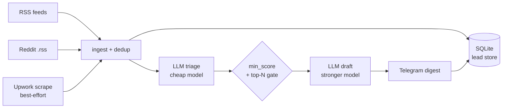

# gig-radar

[](https://github.com/ssh071102-code/gig-radar/actions/workflows/ci.yml)


An automated freelance lead-generation pipeline: it watches multiple job boards, scores every
lead against your positioning with an LLM, drafts a tailored proposal for your best matches, and
pushes the results straight to Telegram.

## What lands in your Telegram

Captured output of `gig-radar demo` -- bundled fixture data, no keys, no network:

```text
gig-radar demo -- bundled fixture data, no network, no API keys

Scored leads (demo fixtures):
   92  ai-integration  [Hiring] Build a support chatbot grounded in our product docs (RAG)
   84  automation      [Hiring] Automate weekly ops reporting from Airtable and Slack
   76  ai-video        [Hiring] AI-generated product demo video for our launch
   28  other           [Hiring] Senior ML engineer, Toptal-vetted only
   12  other           [Hiring] Fix the fonts on my WordPress theme

Drafted proposal for the top lead (92, comment):
  Grounded-in-your-docs chatbot with citations -- shipped this exact thing.
  I built a RAG support chatbot for a docs-heavy SaaS: retrieval over the docs, answers with citations, and a fallback to a human when confidence is low. First-response time went from hours to seconds.
  
  For your ~2k tickets/month I'd start with a one-week scoped build: index your docs, stand up the chat endpoint, and measure deflection on real tickets before you commit further. Happy to share the eval setup I use to keep answers honest.

Exact Telegram message that WOULD be sent for it:
------------------------------------------------------------
Score: 92 | Category: ai-integration | Suggested channel: comment
Title: [Hiring] Build a support chatbot grounded in our product docs (RAG)
Link: https://example.com/jobs/rag-chatbot

Why: Direct wheelhouse fit with a stated budget and clear scope

Draft (English, ready to send)
Opening: Grounded-in-your-docs chatbot with citations -- shipped this exact thing.

I built a RAG support chatbot for a docs-heavy SaaS: retrieval over the docs, answers with citations, and a fallback to a human when confidence is low. First-response time went from hours to seconds.

For your ~2k tickets/month I'd start with a one-week scoped build: index your docs, stand up the chat endpoint, and measure deflection on real tickets before you commit further. Happy to share the eval setup I use to keep answers honest.
------------------------------------------------------------
(demo run: 5 ingested, 5 scored, 3 drafted, 3 would be pushed)
```

## What it does

Every run, gig-radar:

1. **Ingests** fresh listings from pluggable sources (RSS feeds, Reddit hiring boards via
   their logged-out `.rss` route, and a best-effort Upwork saved-search scrape).
2. **Deduplicates** against everything it has already seen, so re-running never produces repeats.
3. **Triages** each new lead with a cheap LLM call, scoring it against your positioning for fit,
   budget signal, and client legitimacy.
4. **Drafts** a tailored, channel-appropriate pitch (Reddit comment, cold email, Upwork cover
   letter, or DM) for only the top-N highest-scoring leads, using a stronger model.
5. **Pushes** each drafted lead as a formatted Telegram message, ready to review and send.
6. **Persists** state to SQLite so nothing is lost: a lead that fails to score is retried next
   run, a lead that fails to push is never marked as sent, and a lead that clears the score bar
   on a busy day but misses the top-N cutoff stays in the scored backlog and surfaces on the
   next quieter run.

## Architecture



Design choices worth calling out:

- **Pluggable source adapters.** Every source implements one `fetch() -> list[RawItem]`
  method (`gig_radar/adapters/`). Adding a new board means writing one adapter, not touching
  the pipeline.
- **Delimited text instead of JSON mode.** Prompts ask for a fixed line-oriented format
  (`SCORE: / CATEGORY: / CHANNEL: / REASON:`) rather than JSON. Small triage models score more
  reliably when they are not also being asked to emit syntactically valid JSON, and a
  line-oriented format degrades one lead instead of failing the whole parse when a response
  comes back malformed. Responses are parsed defensively and enum values are sanitized.
- **Persona and positioning live in config, not code.** The prompts interpolate a `persona:`
  block from `settings.yaml` and your `config/positioning.md`; nothing about a specific person
  is hardcoded in the LLM layer.
- **Graceful degradation everywhere.** A failing source never blocks the others. A lead that
  fails to score or draft is marked and retried, never silently dropped. A failed Telegram send
  never blocks the rest of the batch, and the token-bearing URL is never logged.
- **Cost control by design.** Every fresh lead gets a cheap triage pass; only leads that clear
  both `min_score_to_push` and the `top_n` cutoff get a full drafting pass on a more expensive
  model. Keyword filtering runs at fetch time, before anything reaches an LLM at all.

## Quickstart

```bash
pip install -e ".[dev]"

gig-radar demo   # no keys needed -- full pipeline on bundled fixture data

# real run:
cp secrets/.env.example secrets/.env   # fill in ANTHROPIC_API_KEY, TELEGRAM_BOT_TOKEN, TELEGRAM_CHAT_ID
gig-radar init-positioning             # writes config/positioning.md -- edit it, scoring anchors to it
gig-radar dry-run                      # preview scores + drafts without pushing
gig-radar run
```

Note: `dry-run` skips the Telegram push and all persistence, but it still calls the LLM for
triage and drafting, so it costs a few cents per run. `demo` is the only fully offline command.

## Commands

| Command | What it does |
|---|---|
| `gig-radar demo` | Full pipeline on bundled fixture leads with a deterministic canned LLM. No network, no keys, no env vars. |
| `gig-radar run` | Fetch, dedup, score, draft, push to Telegram, persist state. |
| `gig-radar dry-run` | Same as `run` minus the push and persistence. Still calls the LLM. |
| `gig-radar init-positioning` | Write the positioning template to the config dir. Never overwrites an existing file. |

`run`, `dry-run` and `init-positioning` accept `--config-dir`. The working root (for `config/`,
`secrets/` and `data/`) is the current directory, or `GIG_RADAR_HOME` if set.

## Configuration

`config/settings.yaml`:

| Key | Default | Effect |
|---|---|---|
| `top_n` | `8` | Maximum leads drafted and pushed per run; the rest of the scored backlog waits for the next run. |
| `triage_model` | `claude-haiku-4-5-20251001` | Model for the cheap scoring pass over every fresh lead. |
| `draft_model` | `claude-sonnet-4-6` | Stronger model used only for the top-N drafting pass. |
| `min_score_to_push` | `55` | Leads scoring below this are never drafted or pushed. |
| `enrich` | `true` | Fetch one public page per drafted lead as extra prompt context. |
| `persona.name` | `Laurin` | Name interpolated into the triage and drafting prompts. |
| `persona.wheelhouse` | `AI integration, AI video, automation` | What the prompts score fit against. |
| `persona.experience` | `a cold newcomer with no platform rating, ...` | Experience framing; downweights rating-gated gigs. |

Sources (which boards, feed URLs, fetch-time keyword filters) live in `config/sources.yaml`.
Secrets go in `secrets/.env` (see `secrets/.env.example`); `ANTHROPIC_BASE_URL` optionally
points the SDK at any Anthropic-compatible gateway.

## Status & limitations

- **RSS is the production path.** The default config watches remote-job feeds and Reddit hiring
  boards through their logged-out `.rss` route, so no Reddit API app is needed. A `praw`-based
  Reddit adapter exists behind a config flag if you want authenticated access.
- **The Upwork adapter is best-effort HTML scraping.** Upwork sits behind Cloudflare and
  unauthenticated fetches are often blocked; treat it as a manual review queue, not a reliable
  source. A blocked search is logged and skipped, never fatal.
- **Hacker News and X sources are planned, not implemented.**

## Tech

Python | [httpx](https://www.python-httpx.org/) | [feedparser](https://feedparser.readthedocs.io/)
| [pydantic](https://docs.pydantic.dev/) | [typer](https://typer.tiangolo.com/) | Anthropic SDK |
SQLite | pytest | ruff

## Tests

```bash
pytest
ruff check .
```

61 tests, all offline: HTTP is mocked with respx, feeds parse from local fixtures, and the LLM
layer is replaced with deterministic fakes. Coverage spans the source adapters (RSS, Reddit,
Upwork), the SQLite store, config loading, triage and drafting, Telegram push (including
failure isolation, token secrecy in logs, and message truncation), the CLI, the demo command,
and full pipeline integration tests -- source isolation, dedup, dry-run purity, and the
scored-backlog regression.
